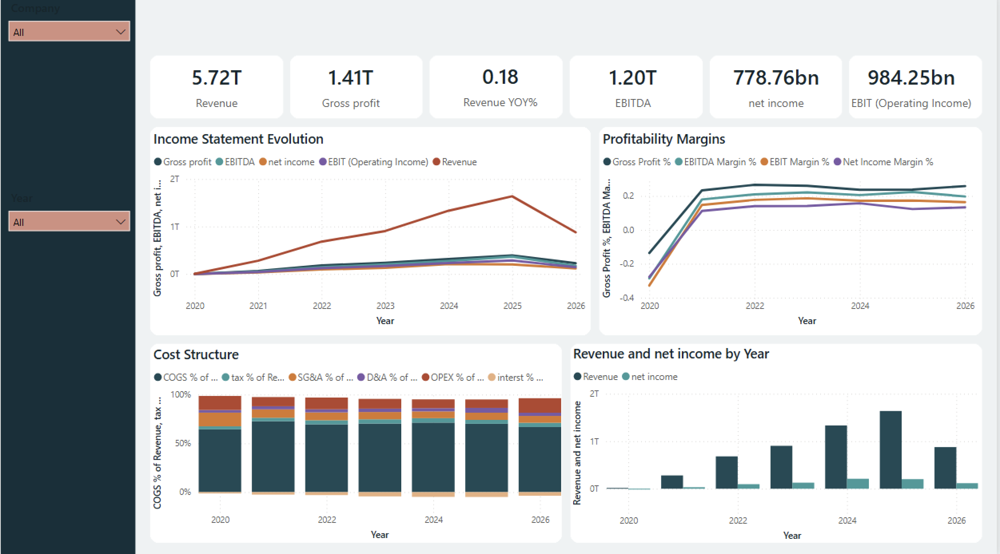
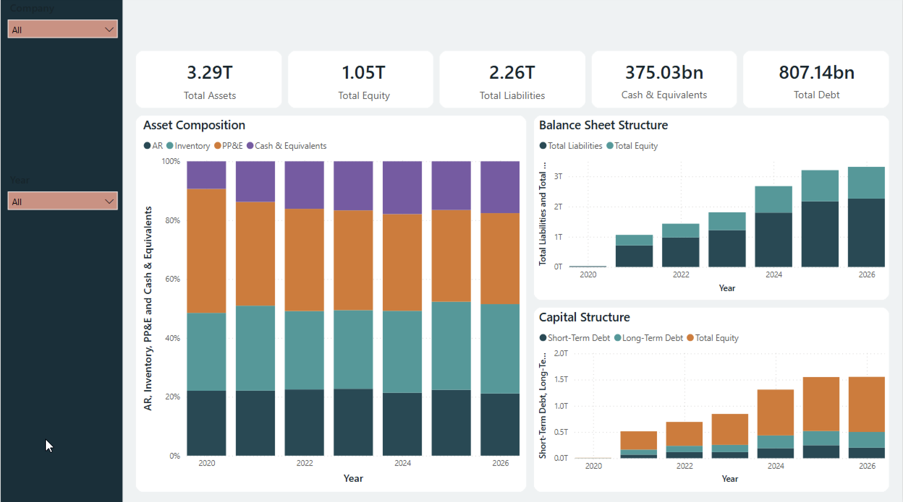
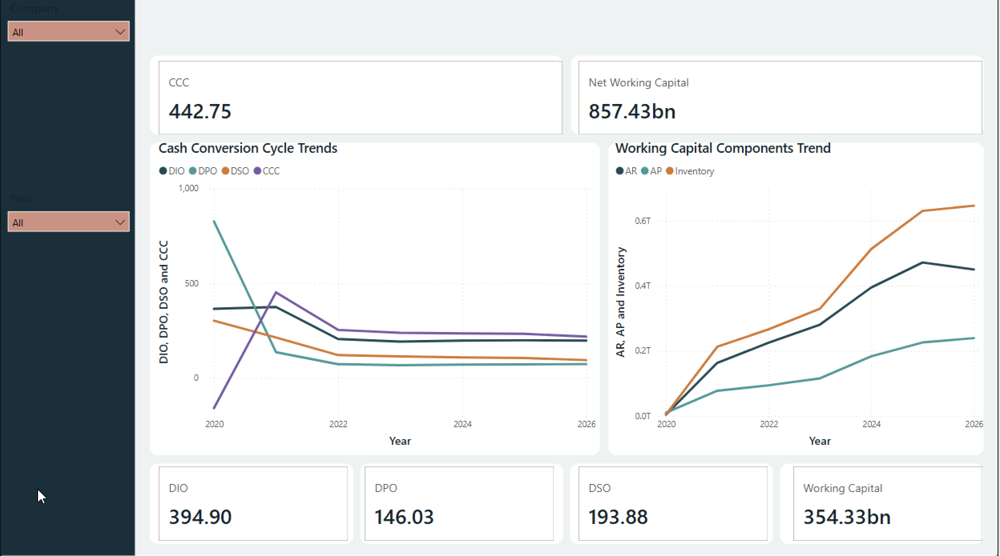
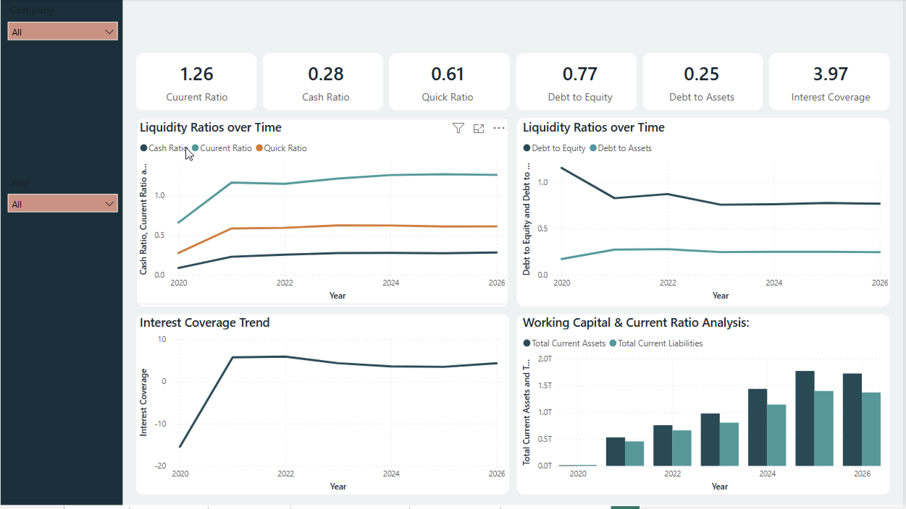
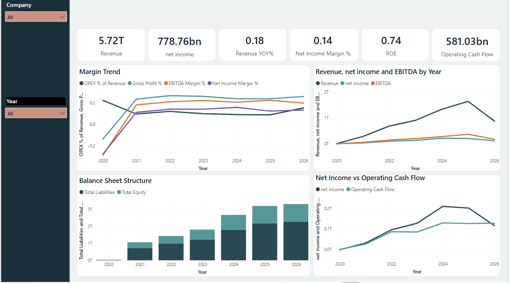
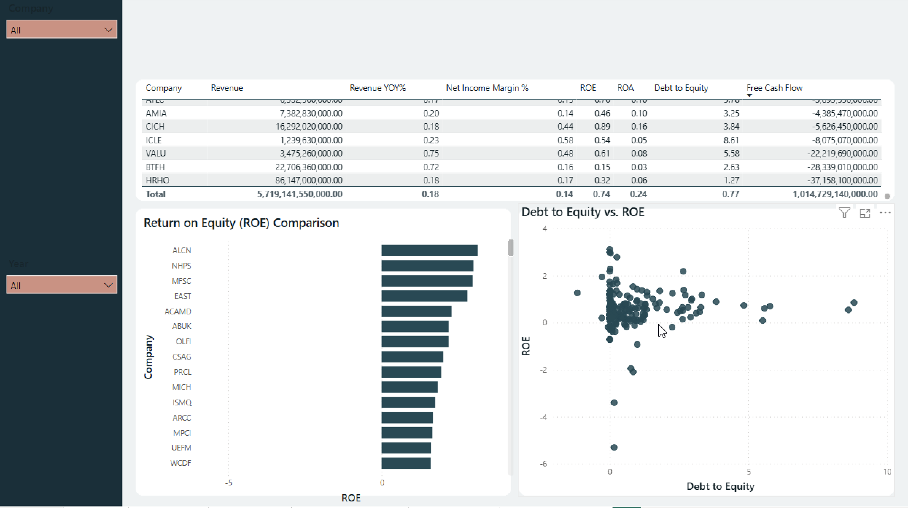

# EGX Financial Data Platform

[](https://python.org)
[](https://spark.apache.org/)
[](https://www.postgresql.org/)
[](https://powerbi.microsoft.com/)
[](#-data-architecture)

> An enterprise-grade, end-to-end data pipeline processing Egyptian Exchange (EGX) non-bank financial datasets. Converts raw market filings into a Star Schema data warehouse and powers validated Power BI executive dashboards.

---

## 🎯 Executive Summary

Financial reporting across emerging markets like the EGX often suffers from disparate reporting formats, inconsistent time-series structures, and aggregation pitfalls. This platform automates the end-to-end flow of financial metrics—including **Total Assets**, **Total Liabilities**, **Shareholders' Equity**, and **Total Revenue**—from web extraction to interactive BI reporting.

### Key Engineering Highlights
* **Medallion Architecture:** Enforces strict physical and logical separation across Bronze (Raw), Silver (Cleansed/Conformed), and Gold (Analytical Serving) layers.
* **DAX & SQL Equivalence:** Resolves financial accounting nuances by reconciling point-in-time **Snapshot metrics** (Balance Sheet items via `LASTNONBLANK` logic) and cumulative **Flow metrics** (Income Statement items) directly in PostgreSQL and DAX.
* **Pre-Scaled Data Modeling:** Optimizes database storage and reporting performance by handling metric precision and unit scaling directly within backend transformations.

---

## 📊 Business Intelligence & Reporting

The platform culminates in a Power BI executive dashboard that translates the underlying Star Schema into actionable financial insights.

### Income Statement & Profitability
Tracks revenue growth, EBITDA, and profitability margins across the sector.


### Balance Sheet & Capital Structure
Visualizes asset composition, total liabilities, and debt-to-equity ratios.


### Liquidity & Working Capital
Monitors the Cash Conversion Cycle (CCC), current ratios, and net working capital components.



### Cash Flow & Margin Trends
Correlates net income with operating cash flow and historical margin trends.


### Company Performance Matrix
Provides cross-company comparisons utilizing DAX snapshot measures for accurate aggregate totals.


---

## 🏗️ Data Architecture

```mermaid
flowchart LR
    subgraph Extraction
        A[EGX Market Filings] -->|egx_scraper.py| B[(Bronze Layer / Raw Data)]
    end

    subgraph Transformation
        B -->|silver_transform.py| C[(Silver Layer / Cleansed)]
        C -->|gold_transform.py| D[(Gold Layer / PostgreSQL DW)]
    end

    subgraph Analytics
        D -->|Optimized Queries| E[Power BI Engine]
        E -->|DAX Snapshot/Flow Logic| F[Executive Dashboard]
    end